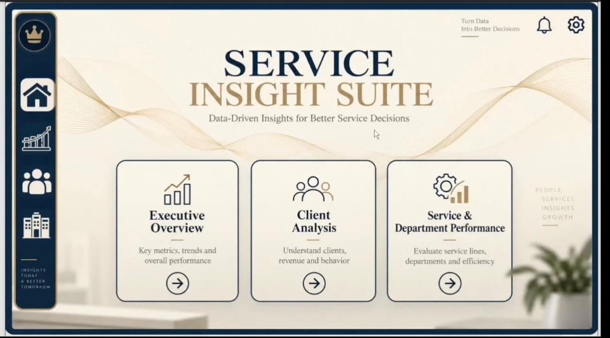
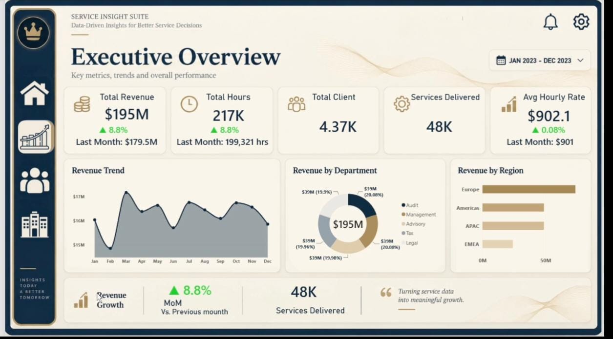
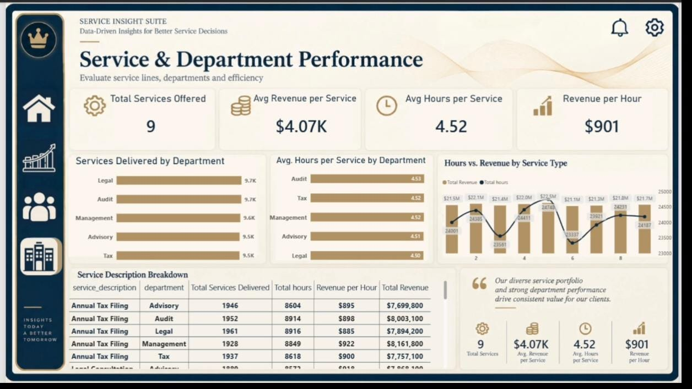
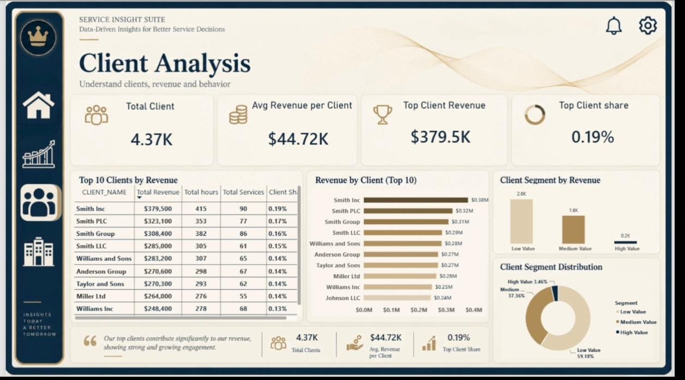

# Service Insight Suite

**Data-Driven Insights for Better Service Decisions**

An interactive Power BI dashboard analyzing a year of service-delivery data for a professional-services business: revenue, hours, clients, departments and service lines, with a custom navigation experience and an executive-style design.

## Project Question

How is the service business performing across revenue, delivery hours, departments and clients, and where do efficiency and concentration risks sit?

## Dashboard Pages

| Page | What it answers |
|---|---|
| **Home** | Landing page with navigation cards to each report section |
| **Executive Overview** | Key metrics, revenue trend, revenue by department and region |
| **Service & Department Performance** | Service-line efficiency: services delivered, hours per service, revenue per hour |
| **Client Analysis** | Client concentration, top clients, and client segmentation |

## Key Metrics (Jan 2023 - Dec 2023)

- **Total Revenue:** $195M
- **Total Hours:** 217K
- **Services Delivered:** 48K
- **Total Clients:** 4.37K
- **Avg Hourly Rate:** $902
- **Revenue growth (Dec, MoM):** +8.8%

## Key Insights

- Revenue is evenly diversified across all five departments (Audit, Management, Advisory, Tax, Legal) at roughly $39M (20%) each, with no single-department dependency.
- Europe is the strongest region, ahead of Americas, APAC and EMEA.
- Delivery efficiency is highly consistent: average hours per service sits around 4.5 in every department, and revenue per hour holds near $901.
- Client base is a true long tail: the largest client (Smith Inc, $379.5K) accounts for only 0.19% of total revenue, so revenue concentration risk is minimal.
- Client segmentation shows 59.2% Low Value, 37.4% Medium Value and only 3.5% High Value clients, pointing at a clear up-sell opportunity.
- December closed the year strong with +8.8% month-over-month revenue growth.

## Data Preparation (SQL)

The raw service-delivery data was cleaned and prepared in SQL before modeling:

- Removed duplicate records and handled missing values in key fields (revenue, hours, client)
- Standardized text columns (trimmed whitespace, unified department and region naming)
- Fixed data types (dates, revenue and hours as numeric)
- Built an analysis view (`V_FACT_SERVICES_ANALYSIS`) joining service records with department, service-type and client attributes
- Created a client segmentation table (`Client Segments`) classifying clients into High / Medium / Low Value tiers based on their revenue
- Built a calendar dimension (`Calender`) for month-level trend analysis

## Data Model

- **Fact table:** `V_FACT_SERVICES_ANALYSIS` (service-delivery records: revenue, hours, department, service type/description, region, client)
- **Dimensions:** `Client Segments`, `Calender`
- **Measures table:** `_mesures` (~30 DAX measures), including:
  - Core KPIs: Total Revenue, Total Hours, Total Services Delivered, Total Clients
  - Efficiency: Avg Hours per Service, Revenue per Hour, Avg Revenue per Service, Avg Hourly Rate
  - Client: Avg Revenue per Client, Top Client Revenue, Client Share, Clients by Segment
  - Time intelligence: Revenue MoM %, trend indicators, last-month comparisons
- **Custom visuals:** HTML Content, KPI Viz

## Tools

- SQL (data cleaning and preparation)
- Power BI Desktop (data modeling, DAX, report design)
- Custom page backgrounds and iconography for the navy/gold/cream theme
- HTML Content custom visual for styled layout elements

## Screenshots

### Home

### Executive Overview

### Service & Department Performance

### Client Analysis

## Files

This repository contains a project overview and dashboard screenshots only. The Power BI report file and underlying data are not distributed.

- `screenshots/` - dashboard page screenshots

## Author

**Zeyad Ashraf** - Data Analyst
[LinkedIn](https://www.linkedin.com/in/zeyad-ashraf-065794371) | [GitHub](https://github.com/Zeyada0) | [Portfolio](https://zeyada0.github.io/portfolio/)
